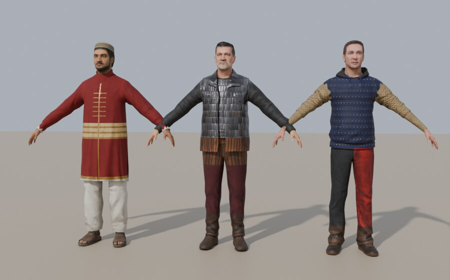

# Fighters: how they are made

| Fighter | Base person | Outfit (painted in texture space) |
|---|---|---|
| Davud, Janissary | Rocketbox `Male_Adult_15` | crimson broadcloth kaftan, gold frogging and hem, striped silk sash, white salvar trousers, leather sandals, embroidered cap |
| Theodoros, Byzantine | Rocketbox `Male_Adult_05` | iron lamellar cuirass with red lacing, mail sleeves, leather pteruges, wine wool trousers, boots |
| Lorenzo, Genoese | Rocketbox `Male_Adult_20` | navy brigandine with gilt rivets, quilted arming sleeves, parti-coloured hose, hood, boots |

## Pipeline

1. `python blender/build_rocketbox.py` (Blender as a Python module)
   - imports each Rocketbox FBX, bakes the centimetre scale into the data, points the head straight up and the hands at the middle finger, parents thighs to the pelvis and collarbones to the chest, and renames the 3ds Max Biped bones to Mixamo names (`Bip01 L UpperArm` becomes `mixamorig:LeftArm`; the 28 facial bones become `face:*`)
   - rasterises every triangle into texture space with its body part (from the skin weights) and its rest-pose 3D position, so garments can be cut by height and side
   - re-dresses the photographed modern clothes: the fold and seam shading of the photo is kept, the cloth colour and weave are replaced, and procedural lamellae, mail rings, rivets and quilting add their own normal-map relief
   - writes colour, normal and an occlusion-roughness-metal map whose red channel is a skin mask for the game's skin shader
   - `--render` makes Cycles previews; otherwise it saves `blender/cast_rb.blend`
2. `python blender/retarget.py --cast cast_rb.blend` moves the 23 clips (Mixamo moves, the hand-built block, dodges and leap, and the Bandai mocap) onto each fighter and exports `public/models/fighter_<id>.glb`
3. `python3 tools/pack.py` packs the GLBs as base64 JSON for the static hosts

## In the game (`arena/fighter.ts`)

- Skin: light wraps past the terminator with red travelling furthest (scattering under the skin) and a second, tighter specular lobe for the oily layer. Cloth gets a soft sheen at grazing angles.
- Hair cards (Theodoros) use alpha test with alpha to coverage.
- Faces are alive: they blink every 2 to 6 seconds, the eyes find the opponent's eyes, struck fighters grimace (brows knit, lids squeeze, mouth corners pull), heavy swings and the leap bare the teeth, the jaw moves with breathing and the eyes roll back on death.

## Licences

- Microsoft Rocketbox avatars: MIT, Copyright (c) 2020 Microsoft. The notice ships with the game in `public/licenses/ROCKETBOX-LICENSE.txt` and is linked from the menu.
- Bandai Namco Research Motion Dataset: CC BY-NC 4.0 (non-commercial). Replace these clips before any commercial release.
- Mixamo animations: Adobe's Mixamo terms.

The previous MPFB (MakeHuman) cast is still buildable with `blender/build_cast.py` and `blender/retarget.py` without `--cast`.
