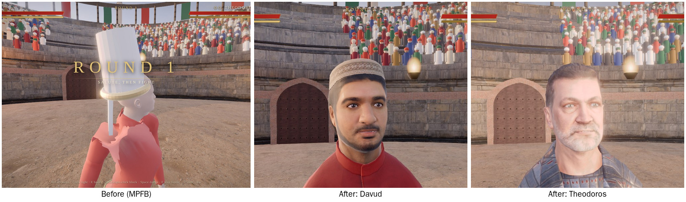

# Kılıç Arena: the road to Call of Duty realism

## 1. The honest answer first

Call of Duty characters are made by teams of hundreds with photogrammetry stages (100+ synchronised cameras), facial performance capture of real actors, hand-sculpted 50,000 to 100,000+ triangle bodies, 4K texture sets, a custom skin, eye and hair renderer, and an engine built around them. A browser game running on an iPad through WebGL cannot match all of that, whoever builds it.

What we can do, and what this pass did, is close the biggest gaps: real photographed people instead of mannequins, period clothing with real fold shading, skin that scatters light, and faces that move. That takes the fighters from "untextured mannequin" to roughly "good PS4-era indie game". The last step to genuine CoD level is a desktop build in Unreal Engine 5 with MetaHumans (section 6), which your gaming PC can run.

## 2. Why the old fighters looked bad (root causes, worst first)

| # | Cause | Effect on screen |
|---|---|---|
| 1 | No textures at all: flat colour per material | plastic, salmon-pink skin; no pores, stubble, eyes or lips |
| 2 | Generated faces (MakeHuman sliders), not real people | the "uncanny mannequin" look |
| 3 | Clothes were offset copies of the skin ("shells") | tights instead of garments, jagged edges at the neck and wrists |
| 4 | No hair, brows or lashes | bald, doll-like heads |
| 5 | Primitive props (a cylinder for the börk) | toy-like silhouette |
| 6 | Standard plastic shading on skin | no scattering, so skin looked like painted wax |
| 7 | Frozen faces | no blinking, no eye contact, no reaction when struck |

## 3. What changed in this pass

| Area | Before | Now |
|---|---|---|
| People | MakeHuman generated bodies | Microsoft Rocketbox scanned-texture avatars (MIT licence): real faces, beards, skin, eyes and teeth, 7,000 to 8,000 triangles, 80 bones including 28 facial bones |
| Clothing | shells in flat colour | the original photographed garments re-dressed in texture space: the photo's folds, seams and creases are kept, the cloth is replaced with period colour and weave. Davud: crimson kaftan with gold frogging, silk sash, white salvar. Theodoros: iron lamellar with red lacing, mail sleeves, leather pteruges. Lorenzo: velvet brigandine with gilt rivets, quilted sleeves, parti-coloured hose |
| Materials | colour only | colour, normal map, roughness, metalness and a skin mask per texel; arena dust collects towards the hem and boots |
| Skin shading | standard plastic | wrap scattering with red travelling furthest, plus a second tight specular lobe for the oily layer |
| Cloth | standard | soft sheen at grazing angles |
| Hair | none | Theodoros has alpha-tested hair cards; the others have photographed hair on the scalp |
| Faces | frozen | blink every 2 to 6 s, eyes track the opponent's eyes, grimace when struck, teeth bared on heavy swings and the leap, breathing jaw, eyes roll back on death |
| Skeleton | MPFB Mixamo rig | Rocketbox Biped renamed to Mixamo names; all 23 clips retargeted (Mixamo, hand-built moves, Bandai mocap) |

Checks run after the change: fight simulator, 20 rounds at champion level: light attacks land 51%, heavies 21%, leaps 36%, rounds average 22.8 s, bodies overlap in 0.02% of frames. Sword grip, hit zones and first person all work with the new skeletons.

## 4. Gap analysis: Call of Duty against Kılıç Arena now

Scores are rough, out of 10, CoD = 10.

| Area | CoD does | We now do | Score | Biggest browser-possible fix |
|---|---|---|---|---|
| Face identity | photogrammetry of actors, 4K maps | real photo textures, 2K | 6 | scan your own faces (see 5.2) |
| Head geometry | 20k to 50k triangle heads | about 2.5k | 4 | sculpted or scanned head meshes, normal maps baked from scans |
| Skin shader | separable subsurface scattering, micro detail, cavity | wrap scattering, dual specular | 5 | screen-space subsurface blur pass, detail normal for pores |
| Eyes | refraction, wet layer, caustics, eyelid shadowing | textured eyeballs | 3 | separate eye mesh with a clearcoat wet layer and an iris parallax shader |
| Hair | thousands of anisotropic cards, strand shading | photo on the scalp, simple cards | 3 | hair-card helmets with anisotropic (Kajiya-Kay) shading |
| Facial animation | 4D facial capture | procedural blinks, gaze, grimace | 4 | ARKit blendshape capture from an iPhone, played as clips |
| Clothing | sculpted garments with real thickness, cloth simulation | texture-painted on the body mesh | 4 | modelled kaftan skirt, cloak and armour plates with simple cloth physics on the skirts |
| Body animation | hours of motion capture, motion matching | 23 clips, crossfades | 5 | more mocap sword clips, motion matching, foot IK |
| Hit reactions | blended physics and animation | animation plus shove | 4 | partial ragdoll on hits, physical deaths |
| Gore and wounds | layered damage masks | wound decals, blood | 4 | wounds painted into a damage mask on the skin and cloth |
| Lighting | baked and real-time global illumination | sun, sky light, ambient occlusion | 5 | baked lightmaps for the arena, light probes for fighters |
| Shadows | cascaded and contact shadows | one 4096 shadow map over 64 m | 4 | cascaded shadow maps so faces get crisp self-shadowing |
| Anti-aliasing and post | temporal AA, motion blur, depth of field, filmic grain | SMAA, bloom, filmic tone map | 5 | temporal AA, per-object motion blur, subtle grain |
| First-person body | full arms and body, weapon animation | camera at the eyes, sword visible | 4 | first-person arms with their own animation layer |

## 5. Roadmap

### 5.1 Next in the browser (no new accounts needed)

1. Cascaded shadows so the face, nose and folds shadow themselves crisply.
2. Screen-space subsurface scattering for skin, and a wet clearcoat layer on the eyes.
3. Modelled garment pieces with physics: kaftan skirt, Theodoros's cloak and helmet, Lorenzo's breastplate, a proper felt börk with its back flap.
4. First-person arms and hands.
5. Wounds painted into a damage mask (cuts open in the cloth, blood soaks into it).
6. Partial ragdoll for hits and deaths; foot IK so feet stay planted.
7. Temporal anti-aliasing, motion blur on fast swings, light film grain.
8. More mocap: the Bandai dataset has more attack and defence takes; CMU and other open libraries add more.

### 5.2 Your own faces (you have an iPad Air M1)

Scan yourself and your friends with a free photogrammetry app (RealityScan or Polycam), clean the scan in Blender, and project the photo texture onto the fighter head. That gives fighters with your faces, at roughly the realism of the current heads but with your identity. Expect an evening of work per face, mostly cleanup.

### 5.3 True Call of Duty level: Unreal Engine 5 desktop build

| Need | Unreal route |
|---|---|
| Characters | MetaHuman Creator: scanned-quality humans with strand hair, skin, eyes and full facial rigs. Since June 2025 the licence also allows use outside Unreal, and it is free under $1M revenue. |
| Facial performance | MetaHuman Animator with an iPhone: your own acting drives the faces |
| Clothing | Chaos Cloth for kaftans and cloaks |
| Lighting and detail | Lumen global illumination, Nanite geometry, virtual shadow maps |
| Hardware | your gaming PC (an RTX-class card) |
| Cost | the online, matchmaking and browser parts of Kılıç Arena would need rebuilding; the combat rules, timings, bots and simulator findings carry over |

## 6. Sources

- MetaHuman licence change, June 2025: https://www.cgchannel.com/2025/06/you-can-now-sell-metahumans-or-use-them-in-unity-or-godot/ and https://www.metahuman.com/license?lang=en-US and https://www.creativebloq.com/3d/metahuman-just-broke-free-from-unreal-engine-5-why-everyone-can-now-create-lifelike-characters and https://digitalproduction.com/2025/06/05/metahumans-graduate-ready-for-unity-godot-and-the-fab-cash-register/
- Microsoft Rocketbox avatars (MIT): https://github.com/microsoft/Microsoft-Rocketbox and https://www.microsoft.com/en-us/research/?p=645105
- HeadBox facial rigs: https://www.microsoft.com/en-us/research/?p=843265; MoveBox motion: https://microsoft.com/en-us/research/?p=940662
- MB-Lab licence (generated characters are AGPL): https://mb-lab-docs.readthedocs.io/en/latest/license.html
- CharMorph (open character generator): https://www.cgchannel.com/2025/03/check-out-new-open-source-3d-character-generator-charmorph/
- Free head scans: https://www.cgchannel.com/2019/06/download-ten24s-free-hi-res-3d-scan-of-a-male-human-head/ and https://www.artec3d.com/3d-models/head
- How Call of Duty uses photogrammetry: https://blog.activision.com/call-of-duty/2019-06/Initial-Intel-How-Photogrammetry-is-Helping-to-Shape-Call-of-Duty-Modern-Warfare-into-a-new-high-watermark-for-graphics-in-gaming
- Activision's photoreal facial pipeline: https://80.lv/articles/activision-a-photoreal-facial-performance-pipeline-for-games/?amp=1
- Material advances in Call of Duty: WWII (skin, cloth, layered materials): https://www.advances.realtimerendering.com/s2018/MaterialAdvancesInWWII.pdf
- Dead Island 2's humans and gore: https://80.lv/articles/dambuster-on-how-dead-island-2-s-zombies-humans-gore-were-made/
- Digital Ira (real-time photoreal faces): https://vgl.ict.usc.edu/Publications/2014/Digital%20Ira%20and%20Beyond%20Creating%20Photoreal%20Real-Time%20Digital%20Characters.pdf
